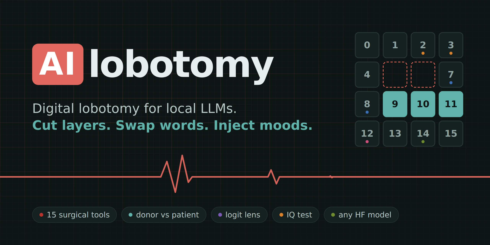
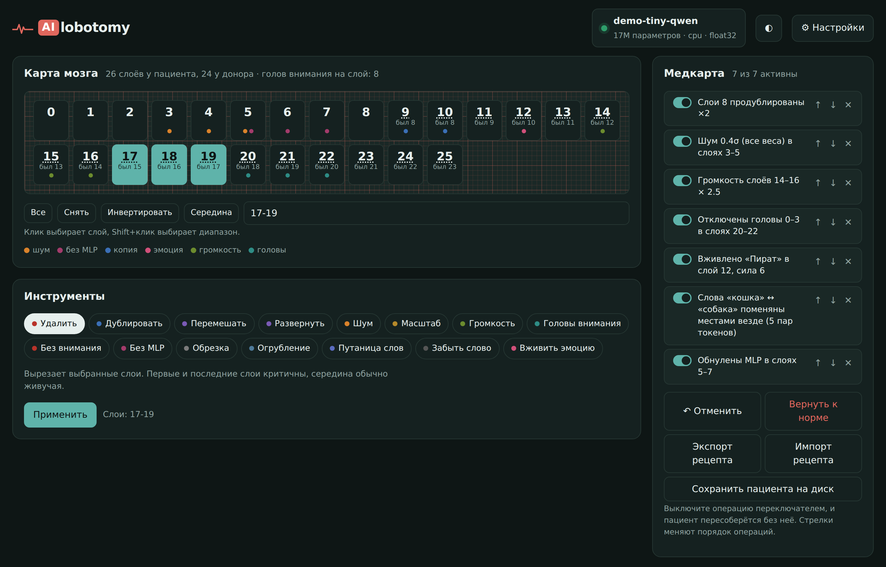
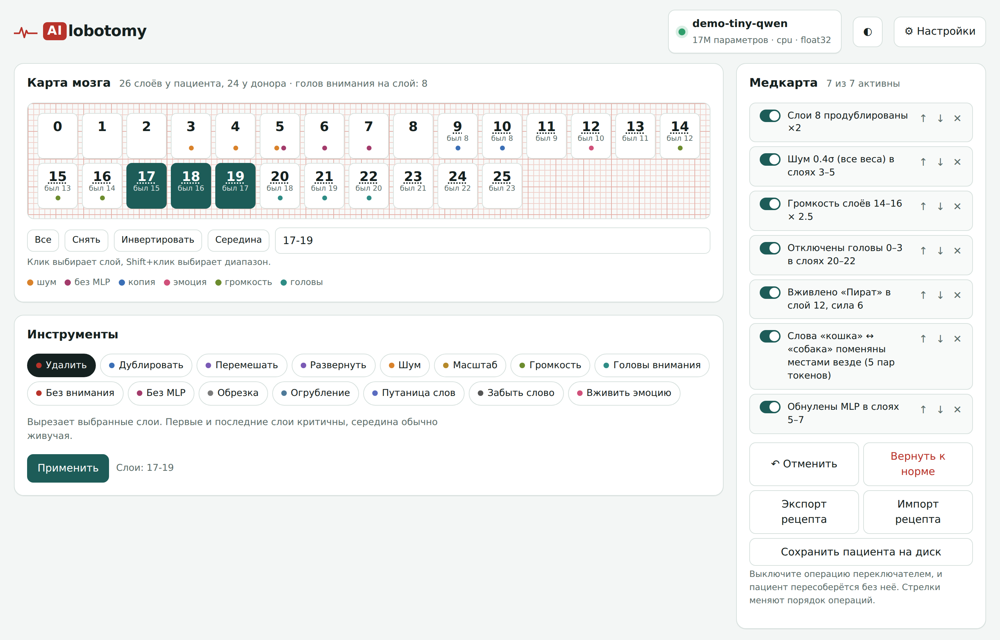
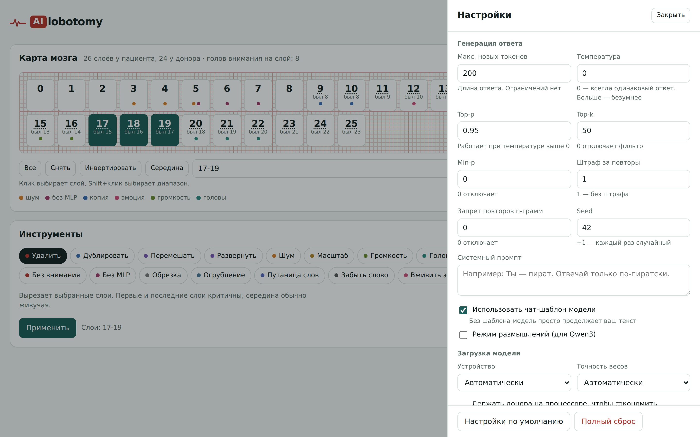
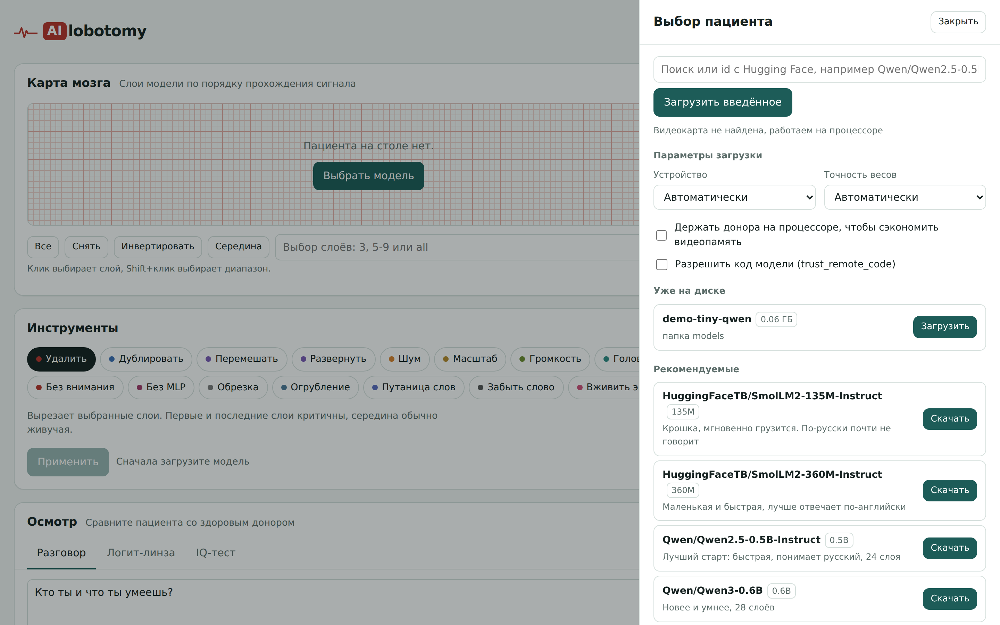

<p align="center">
  
</p>

<p align="center">
  <a href="#-quick-start"></a>
  
  
  
  <a href="LICENSE"></a>
</p>

<p align="center">
  <b>English</b> · <a href="README.ru.md">Русский</a>
</p>

**AIlobotomy** is a surgery room for language models that run on your own machine. Load any model from Hugging Face, cut out layers, shuffle them, pour noise into the weights, make it confuse *cat* with *dog*, inject a pirate mood — and then ask it questions side by side with a healthy copy of itself.

It's a toy, a teaching tool and a tiny interpretability lab in one window. Every change is reversible with one click.

<p align="center">
  
</p>

> [!NOTE]
> The interface is currently in Russian. An English version is on the [roadmap](#-roadmap) — PRs welcome.

## ✨ What you can do

| | Tool | What happens to the patient |
|---|---|---|
| 🔪 | **Delete layers** | Cut any layers out. The middle of the stack is surprisingly resilient, the first and last layers are not. |
| 🧬 | **Duplicate** | Run a layer 2–10 times in a row. The model starts looping or "overthinking". |
| 🔀 | **Shuffle / Reverse** | Change the order in which layers process the signal. |
| 🌫 | **Noise** | Add Gaussian noise to weights — attention only, MLP only, norms or word embeddings. |
| 📏 | **Scale** | Multiply weights by any number, including negative. |
| 🔊 | **Layer volume** | Scale a layer's contribution to the residual stream: `0` = skip, `2` = amplify, `-1` = invert. |
| 👁 | **Attention heads** | Switch off individual heads. |
| 🧠 | **No attention / No MLP** | Zero whole blocks. Without MLPs the model still talks fluently but forgets facts. |
| ✂️ | **Prune** | Zero the weakest N % of weights. |
| 🧱 | **Quantize** | Crush weights down to 1–8 bits. |
| 🐱 | **Word swap** | Swap two words in the vocabulary: the model thinks "cat", says "dog". |
| 🕳 | **Forget a word** | Erase a word from the model's perception. |
| 💉 | **Inject a mood** | Steering vectors: joy, rage, pirate, sleepiness, hunger, paranoia — or your own. |

**And to examine the patient:**

- **Side-by-side chat** — the patient and the healthy donor answer the same question with streaming output.
- **Logit lens** — see which word the model is "thinking of" after every layer.
- **IQ test** — 10 simple questions plus a perplexity check. Watch the intelligence drop as you cut.

**The medical chart** logs every operation. Toggle any of them off, reorder or delete them, and the patient is rebuilt from the donor without it. Export the chart as a **recipe** and share it, or save the lobotomized model to disk as a regular Hugging Face model.

<p align="center">
  
  
</p>

## 🚀 Quick start

### Windows

1. Install [Python 3.10+](https://www.python.org/downloads/) and tick **"Add python.exe to PATH"**.
2. [Download the repository](../../archive/refs/heads/main.zip) and unzip it anywhere.
3. Double-click **`start.bat`**.

The first launch creates a virtual environment and installs PyTorch (the CUDA build if an NVIDIA GPU is found, otherwise the CPU build). Then your browser opens at **http://127.0.0.1:7861**.

### Linux / macOS

```bash
git clone https://github.com/Ks1nax/AIlobotomy.git
cd AIlobotomy
./start.sh
```

Apple Silicon is supported through MPS.

### Which model to start with?



| Model | Size | Notes |
|---|---|---|
| `Qwen/Qwen2.5-0.5B-Instruct` | 0.5B | **Best first patient.** Fast on CPU, 24 layers, speaks many languages |
| `HuggingFaceTB/SmolLM2-360M-Instruct` | 360M | Tiny and quick, English only |
| `Qwen/Qwen3-0.6B` | 0.6B | Newer and smarter, 28 layers |
| `Qwen/Qwen2.5-1.5B-Instruct` | 1.5B | Noticeably smarter, GPU recommended |

Any causal LM from Hugging Face with a Llama-, Qwen-, Mistral-, Phi-, GPT-2- or GPT-NeoX-style layout should work. Paste its id into the model picker.

## 🧪 Experiments to try

Ready-made recipes for `Qwen2.5-0.5B-Instruct` live in [`recipes/`](recipes). Load one with **Import recipe**.

- **Drunk philosopher** — layer volume `2.5` on three middle layers. Confident, then increasingly strange.
- **Amnesia** — zero the MLPs in layers 4–12 and ask for the capital of France. Fluent speech, broken facts.
- **Catdog** — swap *cat* ↔ *dog* everywhere, then ask about dogs.
- **Depressed pirate** — inject *Pirate* into one middle layer and *Joy* with negative strength into the next one.
- **Find the critical layer** — delete layers one at a time and run the IQ test after each. Which one kills the patient?

Found something funny? Share your recipe in [Discussions](../../discussions) or open a PR to `recipes/`.

## 🛠 How it works

Two copies of the model live in memory: the **donor**, which is never touched, and the **patient**. Structural operations rebuild the layer stack (`nn.ModuleList`) and re-index the KV cache. Weight operations edit tensors in place. Layer volume and mood injection are forward hooks on decoder layers that rewrite the residual stream.

The medical chart is the source of truth: when you toggle or reorder an operation, the patient is cloned from the donor again and the whole chart is replayed. That's why everything is reversible and why recipes are reproducible (noise and shuffles store their seeds).

```
server.py          FastAPI backend: model loading, 15 operations, generation, logit lens, IQ test
static/index.html  The whole UI — one file, no build step
start.bat/.sh      One-click launchers that set up a local venv
recipes/           Shareable operation recipes
```

## 🗺 Roadmap

- [ ] English UI and language switch
- [ ] Attention-pattern viewer
- [ ] Recipe gallery with before/after answers
- [ ] GGUF / llama.cpp models
- [ ] Batch experiments: "delete each layer, chart the IQ"

## 🤝 Contributing

Issues, ideas and pull requests are welcome — see [CONTRIBUTING.md](CONTRIBUTING.md). New surgical tools are especially welcome: an operation is just a Python function and a few lines of UI config.

## ⭐ Star history

<a href="https://star-history.com/#Ks1nax/AIlobotomy&Date">
  
</a>

## 📄 License

[MIT](LICENSE). Models you load keep their own licenses.

<p align="center"><sub>No neural networks were permanently harmed. The donor is always fine.</sub></p>
